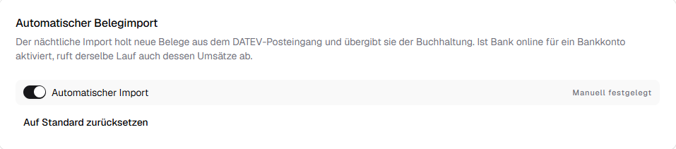
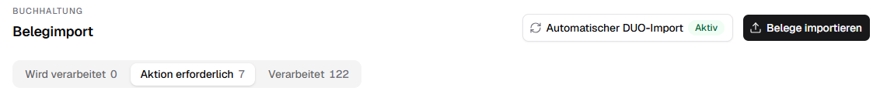
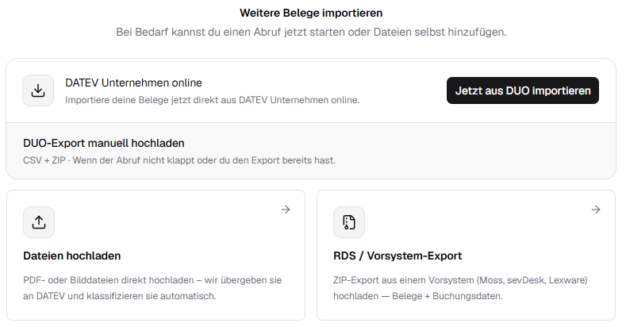
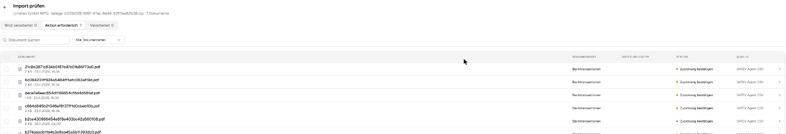

Limetax holt die Belege jede Nacht automatisch aus DATEV Unternehmen online (DUO). Du musst dafür nichts anstoßen — und du siehst am Morgen alles, was in DUO noch offen ist.

## Für welche Mandanten der Import gilt

Der Import funktioniert nur für Mandanten, die ihre Belege in DATEV Unternehmen online hochladen. Mandanten ohne DUO oder mit eigener Buchhaltungssoftware (z. B. Lexware) lassen sich so nicht importieren — dort bleibt der Import aus.

Du schaltest ihn je Mandant unter **Stammdaten → Automatischer Belegimport** mit dem Schalter **Automatischer Import** ein oder aus. Ohne deine Wahl wird er aktiv, sobald der erste Beleg hochgeladen wurde. Hast du selbst geschaltet, steht rechts **Manuell festgelegt**; über **Auf Standard zurücksetzen** gibst du die Entscheidung wieder ab.

<Frame caption="Schalter für den automatischen Belegimport in den Stammdaten">
  
</Frame>

Ist für ein Bankkonto zusätzlich **Bank online** aktiviert, holt derselbe nächtliche Lauf auch dessen Umsätze ab — der Schalter betrifft also nicht nur Belege.

Meldet der letzte Lauf „Der Mandant ist in diesem DATEV-Konto nicht verfügbar", zeigt die Mandantenseite das neben dem Schalter an. Nutzt der Mandant DUO nicht, schalte den Import aus. Sonst prüfe die Mandanten-Zuordnung und die DATEV-Berechtigungen.

## Den Import von Hand starten

Warte nicht auf die Nacht, wenn der Mandant gerade etwas nachgereicht hat. Gehe zu **Buchhaltung → 1 Belege importieren**. Die Seite heißt **Belegimport**.

Oben rechts siehst du zwei Dinge: den Status **Automatischer DUO-Import** mit der Marke _Aktiv_ oder _Inaktiv_, und daneben den Button **Belege importieren**.

<Frame caption="Status des automatischen DUO-Imports und Button Belege importieren">
  
</Frame>

Der Button startet noch keinen Abruf, sondern öffnet die Auswahl **Weitere Belege importieren** mit vier Wegen:

- **DATEV Unternehmen online** — der Regelfall. Klicke auf **Jetzt aus DUO importieren**.
- **DUO-Export manuell hochladen** — CSV + ZIP, wenn der Abruf nicht klappt oder du den Export schon hast.
- **Dateien hochladen** — einzelne PDF- oder Bilddateien, die an DATEV übergeben und automatisch klassifiziert werden.
- **RDS / Vorsystem-Export** — ZIP aus Moss, sevDesk oder Lexware Office, Belege plus Buchungsdaten.

<Frame caption="Die vier Wege, Belege zu importieren">
  
</Frame>

Nach **Jetzt aus DUO importieren** startet Limetax die DATEV-Sitzung selbst — du brauchst dafür weder QR-Code noch SmartLogin-App. Die Seite meldet erst _DATEV-Sitzung wird gestartet_, dann _Belege werden aus DATEV abgerufen_. Das dauert ein bis zwei Minuten, und du kannst die Seite in der Zeit verlassen.

Danach landest du auf **Import prüfen**: Limetax entpackt das Belegpaket aus DUO und listet die Dokumente mit Dokumentart, DATEV-Belegtyp, Status und Quelle. Belege, denen etwas fehlt, stehen unter **Aktion erforderlich** — bei Banktransaktionen typischerweise mit _Zuordnung bestätigen_. Erst wenn du die abgearbeitet hast, laufen sie weiter in die Belegliste.

<Frame caption="Importierte Belege prüfen, bevor sie in die Belegliste laufen">
  
</Frame>

Zurück auf der Seite **Belegimport** klappst du unten den **Importverlauf** auf und siehst, wann der letzte Lauf war und was er gebracht hat.

## Was der Import holt

Maßgeblich ist allein der Status in DUO: Limetax holt **nur Belege, die dort als nicht gebucht geführt werden**. Alles, was DUO als gebucht kennt, bleibt liegen.

Beim ersten Lauf für einen Mandanten kommt deshalb der gesamte Rückstand auf einmal. Wenn in DUO noch Belege aus mehreren Monaten offen stehen, landen sie in einer Nacht in deiner Liste — in einem Fall waren das über 160 Stück. Das sind keine Duplikate und kein Fehler, sondern der Bestand, den DUO bis dahin als offen geführt hat. Ab dem zweiten Lauf kommen nur noch die neuen Belege dazu.

## Warum längst gebuchte Belege wieder auftauchen

DUO leitet den Status **nicht** aus den Buchungen ab. Er wechselt erst auf gebucht, wenn Kanzlei-Rechnungswesen die Buchungsinformationen an DUO zurückgibt. Ein Beleglink allein genügt dafür nicht.

Passiert diese Rückgabe nicht, steht ein Beleg in DUO dauerhaft auf nicht gebucht — auch wenn er längst festgeschrieben ist — und der Import holt ihn mit.

Damit dir das nicht als Arbeit auf den Tisch kommt, gleicht Limetax jeden Beleg vor dem Import gegen die Buchungen ab, die aus DATEV synchronisiert werden:

- Trägt eine Buchung den **Beleglink** des Belegs, wird er direkt als *Bereits in DATEV gebucht* geschlossen.
- Stimmen nur **Rechnungsnummer und Betrag** überein, bekommst du *Möglicherweise bereits gebucht* und entscheidest selbst. Ist der Treffer falsch, öffne den Beleg unter **Belege importieren** und wähle **Trotz allem verarbeiten**.

## Die Rückgabe an DUO dauerhaft einschalten

{/* TODO vor dem Merge: Menüpfade mit Chris/Johan gegen die DATEV-Dokumentation prüfen — Quelle bisher DATEV-Community. */}

Die saubere Lösung liegt in DATEV, nicht in Limetax. In Kanzlei-Rechnungswesen aktivierst du je Mandant **Buchungsinformationen beim Schließen der Belegerfassung übergeben**. Das setzt Belege online als Archivsystem voraus.

Für das laufende Jahr gibst du die Informationen einmalig nach: **Abschließende Tätigkeiten → Buchungsinformationen übergeben**. Danach stimmt der Status in DUO, und gebuchte Belege kommen gar nicht erst bei dir an.

## Wenn Rechnung und Zahlungsbeleg doppelt ankommen

Manche Mandanten laden Rechnung und Zahlungsbeleg getrennt in DUO hoch, etwa `Invoice-8LQX9ROP.pdf` und `Receipt-2981.pdf`. Für DUO sind das zwei Belege, und daraus können zwei Eingangsrechnungen entstehen.

Die Dublettenprüfung läuft deshalb nach der Belegerkennung noch einmal. Stimmen Rechnungsnummer, Datum, Betrag und Währung mit einer anderen Rechnung überein, wird die zweite als Duplikat gehalten und lässt sich nicht freigeben. Entscheide dann, welche du behältst, und archiviere die Kopie.

<Warning>
  Prüf bei doppelten Paaren auch den Stapel in DATEV. Ist die Rechnung dort bereits zweimal gebucht, musst du eine der beiden Buchungen stornieren — das Archivieren in Limetax räumt nur die Liste auf, nicht die Primanota.
</Warning>

## Belege, die du nach dem Import in DATEV buchst

Diese Buchung bekommt Limetax nicht zurückgemeldet. Der Beleg bleibt bei dir auf **Offen** stehen, obwohl er erledigt ist. Öffne ihn und klicke auf **Archivieren** (Strg/Cmd + A). Er verschwindet damit aus allen Reitern und lässt sich jederzeit wiederherstellen.

<Columns cols={2}>
  <Card title="Die Status verstehen" icon="list-check" href="/rechnungen/status-verstehen">
    Offen, Freigegeben, Übermittelt und was dahintersteckt.
  </Card>

  <Card title="Fehlende Belege anfordern" icon="envelope" href="/belege/fehlende-belege-anfordern">
    Was tun, wenn ein Beleg gar nicht erst in DUO liegt.
  </Card>
</Columns>
