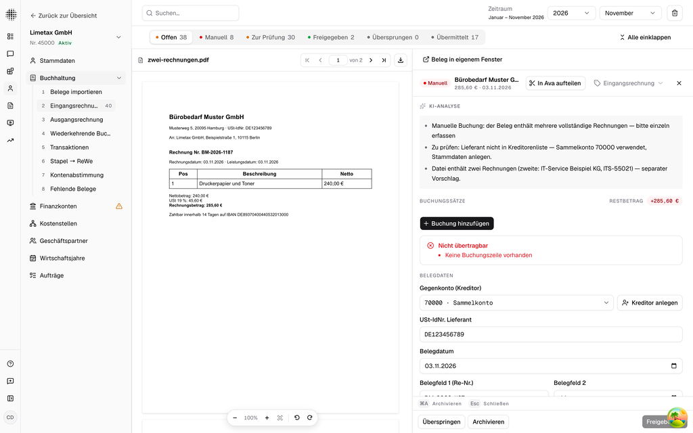
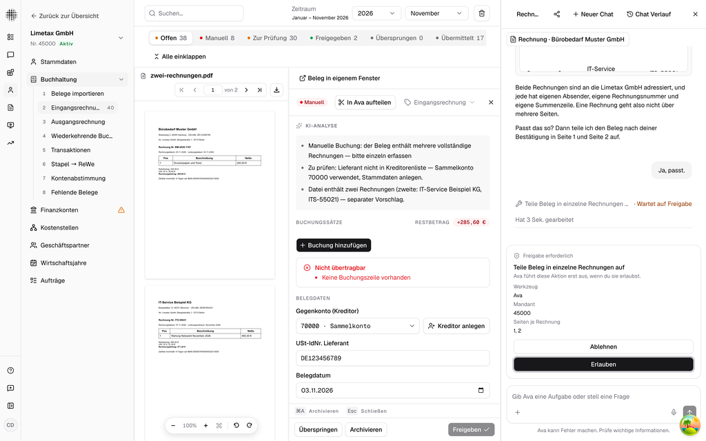
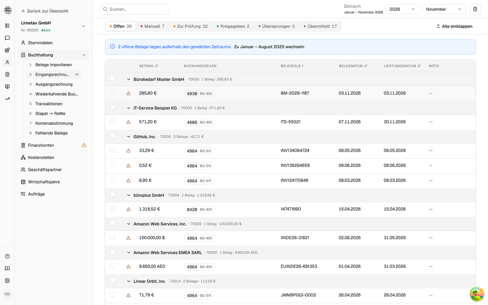
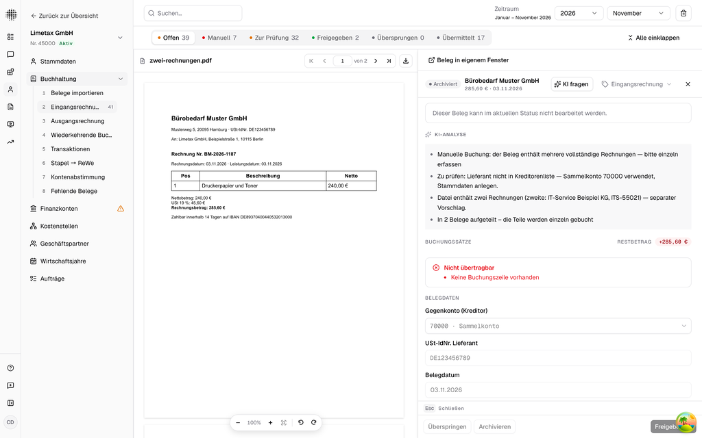

Sammel-Downloads aus Lieferantenportalen enthalten oft mehrere Rechnungen in einer PDF — nicht selten von verschiedenen Kreditoren. Daraus lässt sich kein sauberer Buchungssatz bauen: Jede Rechnung braucht ihr eigenes Gegenkonto, ihre eigene Rechnungsnummer und ihr eigenes Belegdatum.

Limetax erkennt das und hält den Beleg zurück, statt einen gemischten Vorschlag zu erzeugen. Er steht dann unter **Manuell** und trägt den roten Tag **Mehrere Belege**. In der KI-Analyse steht daneben, welche weitere Rechnung erkannt wurde, samt Nummer.

## So teilst du auf

Öffne den Beleg. Im Kopf des Drawers steht neben dem Status **In Ava aufteilen**. Der Button erscheint nur bei Belegen, die aus genau diesem Grund gehalten werden.

<Frame caption="Gehaltener Beleg mit dem Button In Ava aufteilen">
  
</Frame>

Ein Klick öffnet den Chat mit einer vorbereiteten Anfrage. Ava liest die Datei und schlägt eine Aufteilung vor: eine Tabelle mit Beleg, Seite, Rechnungssteller und Rechnungsnummer, dazu die Begründung — eigener Absender, eigene Rechnungsnummer, eigene Summenzeile je Rechnung. Prüf das gegen das Belegbild und antworte.

Danach kommt die Freigabekarte **Teile Beleg in einzelne Rechnungen auf**. Sie zeigt Werkzeug, Mandant und die Seiten je Rechnung. Ava führt die Aktion erst aus, wenn du auf **Erlauben** klickst.

<Frame caption="Freigabekarte mit den Seiten je Rechnung">
  
</Frame>

## Was danach passiert

Limetax legt pro Rechnung einen eigenen Beleg an, jeder mit nur seinen Seiten. Die Vorkontierung läuft neu, danach liegen die Teile unter **Zur Prüfung** mit dem gelben Tag **Aufgeteilter Beleg**. Prüf, ob die Seitengrenze stimmt, und buch sie dann wie jeden anderen Beleg.

<Frame caption="Die beiden Teile als eigene Belege in der Liste">
  
</Frame>

Steht ein Kreditor noch nicht in der Kreditorenliste, kontiert Limetax den Teil vorerst auf das Sammelkonto **70000**. Leg die Stammdaten an und setz das richtige Gegenkonto, bevor du freigibst.

## Was mit der Datei in DATEV passiert

Nichts. Es wird keine Datei neu hochgeladen und nichts doppelt abgelegt.

Beide Teile hängen am selben DATEV-Beleg — DATEV erlaubt mehrere Buchungen auf dasselbe Dokument. In DATEV Unternehmen online liegt also weiterhin die eine Original-PDF, an der später beide Buchungen hängen.

Das Original in Limetax wird **archiviert**. Im Drawer steht dann *Dieser Beleg kann im aktuellen Status nicht bearbeitet werden*. Das ist Absicht: So kann dieselbe Rechnung nicht zusätzlich als Ganzes in den Buchungsstapel laufen.

{/* TODO Lora: Bei Belegen von vor TEC-3067 steht in der KI-Analyse „In 2 Belege aufgeteilt“ (siehe Bild unten). Laut Code wird dieser Text weiter geschrieben, aber nur noch bei Belegen ohne Tags angezeigt. Bei neuen Belegen fehlt der Hinweis vermutlich. Mit Tech klären, dann Text und Bild anpassen. */}

<Frame caption="Das archivierte Original mit dem Hinweis auf die Aufteilung">
  
</Frame>

<Warning>
  **Beachte!** Prüf die Seitenbereiche, bevor du auf **Erlauben** klickst. Nach dem Aufteilen ist das Original gesperrt — eine falsche Grenze korrigierst du nur noch über die einzelnen Teile.
</Warning>

<AccordionGroup>
  <Accordion title="Der Button In Ava aufteilen wird nicht angezeigt">
    Der Beleg wird aus einem anderen Grund gehalten. Schau auf die Tags in der KI-Analyse: Steht dort **Ohne Historie**, **Rechnungsabgrenzung** oder **Bewirtung**, ist Aufteilen nicht der richtige Weg. Die Funktion ist keine allgemeine Schere für beliebige PDFs.
  </Accordion>

  <Accordion title="Mehrere Rechnungen desselben Kreditors in einer Datei">
    Sammelrechnungen eines Anbieters werden als eine Rechnung erkannt, solange sie als ein Dokument geliefert werden.
  </Accordion>

  <Accordion title="Ein Teil enthält die falschen Seiten">
    Teil archivieren und die betroffenen Seiten als eigenen Beleg neu bereitstellen. Das aufgeteilte Original bleibt gesperrt.
  </Accordion>
</AccordionGroup>

<Columns cols={2}>
  <Card title="Splitbuchungen" icon="divide" href="/rechnungen/splitbuchungen">
    Eine Rechnung auf mehrere Sachkonten verteilen — nicht zu verwechseln.
  </Card>

  <Card title="Status verstehen" icon="circle-info" href="/rechnungen/status-verstehen">
    Warum ein Beleg gehalten wird und was die Status bedeuten.
  </Card>
</Columns>
