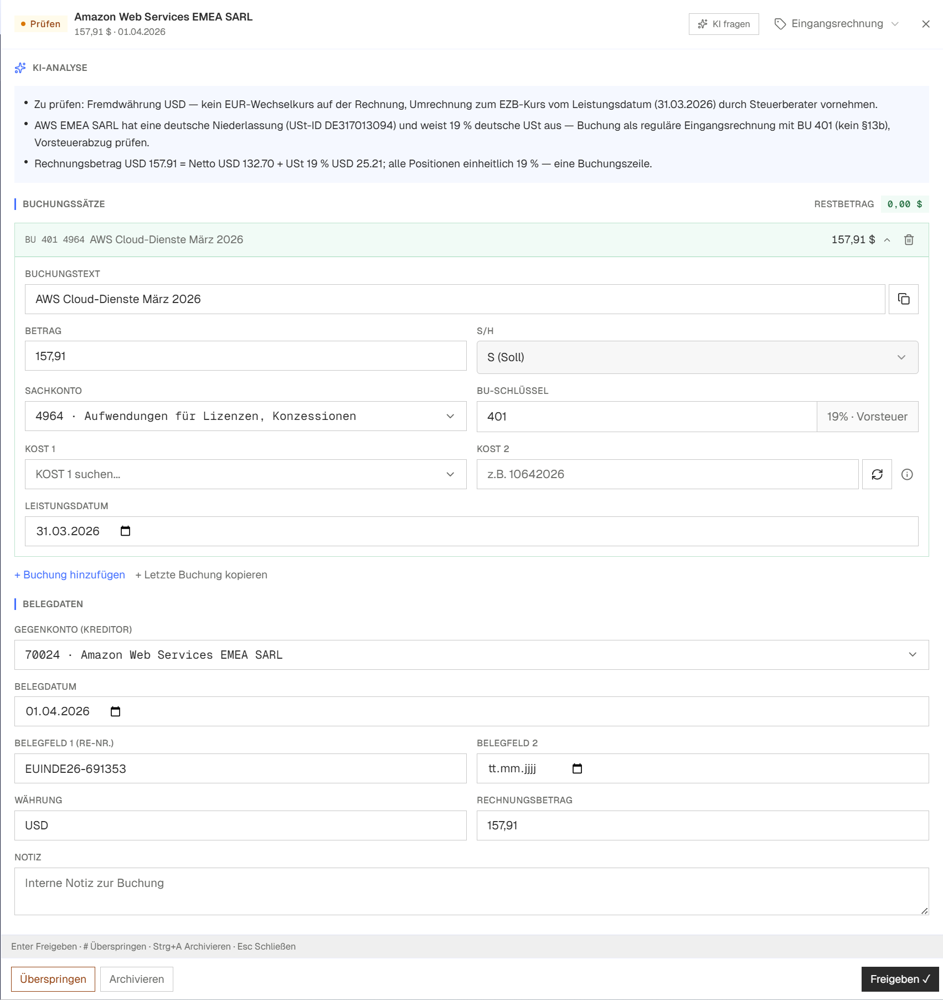
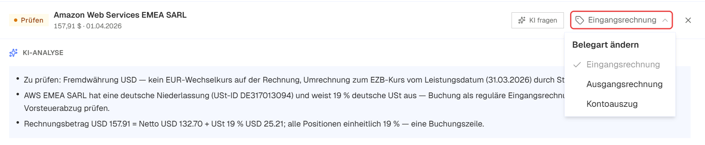

Nach dem Import liegen die Belege vorkontiert in der App. Du prüfst sie und gibst sie frei. Mit der Freigabe wird aus dem KI-Vorschlag deine Buchung. Sie geht beim nächsten Export in den Buchungsstapel und ist ab dann in DATEV.

<Note>
  Alle Kosten laufen über **Kreditoren** im 70000er-Bereich. Gehört ein Beleg dort nicht hin, buchst du ihn manuell.
</Note>

Gehe in der Seitenleiste zu **Buchhaltung → 2 Eingangsrechnung**. Oben stehen die Status: **Offen**, **Manuell**, **Zur Prüfung**, **Freigegeben**, **Übersprungen**, **Übermittelt**. Unter **Zur Prüfung** liegen die Belege, die die KI kontiert hat, bei denen sie sich aber nicht sicher war.

## Wie die Liste aufgebaut ist

Die Rechnungen sind nach **Kreditor** gruppiert. Im Gruppenkopf stehen Kreditorenname, Kreditorenkonto, Anzahl der Belege und die Summe, etwa `Framer B.V. · 70012 · 3 Belege · 101,15 €`. Bereits übertragene Gruppen starten zugeklappt. Über **Alle einklappen** oben rechts räumst du die ganze Liste zusammen.

Pro Zeile siehst du Betrag, Buchungszeilen, Belegfeld 1, Belegdatum, Leistungsdatum und Notiz. Die Buchungszeilen stehen als Badge `4964 · BU 401`. Ein `+1` daneben heißt: es gibt weitere Zeilen. Fahr mit der Maus über das Badge, dann siehst du alle Zeilen mit Konto, BU-Schlüssel, Betrag und Leistungsdatum, ohne den Beleg zu öffnen.

{/* TODO Screenshot: gruppierte Liste im Status Zur Prüfung, eine Gruppe aufgeklappt (Mustermandant 45000) */}

## Einen Beleg prüfen

Klick auf eine Zeile, dann öffnet sich die Detailansicht: links das Belegbild, rechts die Kontierung.

Im Bereich **Buchungssätze** prüfst du Sachkonto, BU-Schlüssel, Betrag und gegebenenfalls die Kostenstelle. Der **Restbetrag** unter den Zeilen muss auf 0,00 € stehen. Steht dort noch etwas, geht die Buchung nicht auf. Bei mehreren Kostenarten teilst du sie über [Splitbuchungen](/rechnungen/splitbuchungen) auf.

<Frame>
  
</Frame>

Darunter gleichst du die **Belegdaten** gegen das Belegbild ab. Das **Belegdatum** bestimmt die Periode. Ein falsches Datum verschiebt die Buchung in den falschen Monat und damit in die falsche UStVA. **Belegfeld 1** trägt die Rechnungsnummer des Lieferanten. Fehlt sie, wird die Offene-Posten-Verwaltung in DATEV unbrauchbar und die App erkennt Dubletten schlechter. In **Belegfeld 2** steht das Zahlungsziel, sofern der Mandant dieses Feld nutzt. Siehe [Belegfeld 2 und Leistungsdatum](/export/belegfelder-pro-mandant).

### Deine Checkliste pro Beleg

- Passt das Sachkonto zum Lieferanten und zur Leistung?
- Stimmt der BU-Schlüssel, besonders bei Auslandsbelegen?
- Ist der richtige Kreditor hinterlegt?
- Stimmen Belegdatum und Rechnungsnummer mit dem Belegbild?
- Steht der Restbetrag auf 0,00 €?

Passt alles, drücke `Enter` oder klicke auf **Freigeben**. Weitere Tastenkürzel stehen unten in der Detailansicht: `#` überspringt, `Strg+A` archiviert, `Esc` schließt.

## Mehrere Rechnungen auf einmal freigeben

Bei wiederkehrenden Lieferanten musst du nicht jeden Beleg einzeln öffnen. Hak die Checkbox im Gruppenkopf an, dann ist die ganze Kreditorengruppe ausgewählt. Einzelne Zeilen kannst du auch direkt anhaken. Unten erscheint eine Leiste mit Anzahl und Summe, etwa `4 Belege ausgewählt · 561,36 €`. Mit **Freigeben** gibst du alle auf einmal frei, mit dem **✕** verwirfst du die Auswahl.

{/* TODO Screenshot: Kreditorengruppe ausgewählt, Auswahlleiste mit Freigeben (Mustermandant 45000) */}

Nutz das für Gruppen, bei denen Gegenkonto und BU-Schlüssel über alle Belege gleich sind. Der Hover über die Badges reicht dafür meist aus. Sobald eine Zeile ein anderes Konto oder einen Zähler `+1` zeigt, öffne sie einzeln.

<Warning>
  **Beachte!** Die Sammelfreigabe prüft nichts. Sie macht aus allen ausgewählten Vorschlägen Buchungen, auch aus den falschen.
</Warning>

Belege, die so nicht freigegeben werden können, haben eine **gestrichelte, nicht klickbare Checkbox** und ein Verbotssymbol. In der Spalte Buchungszeilen steht dann **Keine Buchungszeilen**, der Betrag ist 0,00 €. Diese Belege öffnest du einzeln und kontierst sie von Hand.

Schlägt eine Sammelfreigabe teilweise fehl, bleiben die nicht freigegebenen Belege ausgewählt. Du siehst also direkt, welche übrig sind.

## Wenn du nicht weiterkommst

Du brauchst eine **Rückfrage beim Mandanten**: **Überspringen**. Der Beleg bleibt im Workflow, wandert aber nicht in den Stapel.

Der Beleg ist eine **Dublette**: **Archivieren**. Nicht wegbuchen. Sonst hast du den Aufwand doppelt und die Zahlung findet später keinen eindeutigen Beleg.

Der Beleg ist **unleserlich oder der Sachverhalt unklar**: Status **Manuell**, von Hand buchen.

Die **Belegart ist falsch erkannt**, in der Eingangsrechnungsliste liegt eine Ausgangsrechnung oder ein Kontoauszug: In der Kopfzeile über **Belegart ändern** auf die richtige Art umstellen. Nicht archivieren. Der Beleg ist nicht falsch, nur falsch einsortiert, und beim Archivieren fällt er aus dem Prozess.

<Frame>
  
</Frame>

Der **Kreditor ist nicht eindeutig zugeordnet**, im Gegenkonto steht **70000 · Sammelkonto**: Über **\+ Kreditor anlegen** im Hinweis der KI-Analyse ein eigenes Kreditorenkonto erzeugen. Der Ablauf steht in [Kreditor in DATEV anlegen](/rechnungen/kreditor-anlegen). Nicht auf dem Sammelkonto freigeben. Sonst ist die Offene-Posten-Verwaltung für diesen Lieferanten hin.

Die Rechnung betrifft **mehrere Monate**, etwa Jahreslizenz, Versicherung oder Wartungsvertrag: An der Buchungsposition eine **Rechnungsabgrenzung** einrichten statt den vollen Betrag in einen Monat zu buchen. Der Ablauf steht in [Wiederkehrende Buchungen](/rechnungen/wiederkehrende-buchungen).

<Warning>
  **Beachte!** Lass Rückfragen nicht liegen. Jeder übersprungene Beleg blockiert am Monatsende den Abschluss, weil er nicht in den Stapel geht und der Monat damit unvollständig bleibt. Sammle die Fälle und fordere sie gebündelt an.
</Warning>

<Columns cols={2}>
  <Card title="Aufbau der Belegansicht" icon="table-columns" href="/rechnungen/belegansicht">
    Die fünf Bereiche des Bearbeitungsfelds im Detail.
  </Card>

  <Card title="Fehlende Belege anfordern" icon="envelope" href="/belege/fehlende-belege-anfordern">
    Rückfragen gebündelt an den Mandanten schicken.
  </Card>
</Columns>
