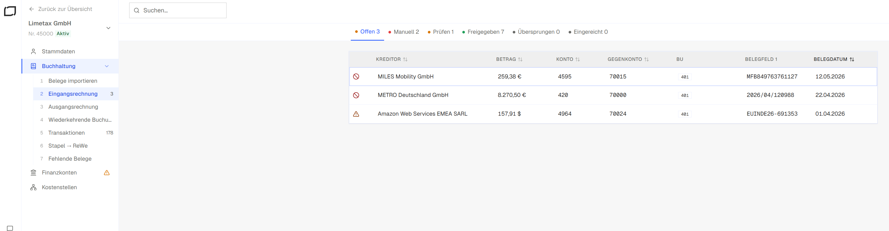

Über der Belegliste stehen die Status als Reiter mit Zähler. Sie sind keine Sortierung, sondern deine Arbeitsliste: Der Zähler sagt dir, wie viel noch zu tun ist, und der Status sagt dir, welche Art von Arbeit es ist.

Die Reihenfolge der Reiter ist immer dieselbe: **Offen · Manuell · Zur Prüfung · Freigegeben · Übersprungen · Übermittelt**. Da **Offen** die Summe aus Manuell und Zur Prüfung ist, ergibt die Zeile gelesen von links nach rechts genau deinen Arbeitsweg.

<Frame caption="Status-Leiste über der Belegliste mit den Zählern">
  
</Frame>

## Die Status, die Arbeit bedeuten

**Offen** ist die Summe aus Manuell und Zur Prüfung — also alles, was noch dein Zutun braucht. Das ist die Zahl, die am Monatsende auf null stehen muss.

**Manuell** heißt: Die KI konnte keine sichere Buchung erstellen. Sie hat es nicht schlecht gemacht, sie hat es gar nicht gemacht. Typische Gründe sind ein unleserlicher Beleg, fehlende wesentliche Angaben oder eine erkannte Dublette. Diese Belege erfasst du vollständig selbst.

**Zur Prüfung** heißt: Die KI hat kontiert, ist sich aber nicht sicher. Der Unterschied zu Manuell ist wichtig — hier liegt ein vollständiger Vorschlag vor, du kontrollierst und korrigierst nur. Warum sie unsicher war, steht in der KI-Analyse am Beleg, und das ist dein Prüfauftrag.

## Die Status, die keine Arbeit bedeuten

**Freigegeben** ist fertig und geht beim nächsten Export in den Stapel. Bei automatischen Freigaben ziehst du trotzdem Stichproben.

**Übermittelt** heißt, der Beleg ist per Stapel an Kanzlei-Rechnungswesen übergeben. Ab hier arbeitest du in DATEV weiter, nicht mehr hier.

Dieser Reiter sieht anders aus als die übrigen: Statt der Belegliste bekommst du eine Tabelle der übergebenen Buchungen mit den DATEV-Feldern — **Kreditor**, **Betrag**, **Konto**, **Gegenkonto**, **BU**, **Belegfeld 1** und **Belegdatum**. Jede Zeile trägt einen doppelten Haken.

Nutze diese Ansicht als Gegenkontrolle nach dem Export: Was hier steht, ist genau das, was in der Primanota ankommen muss. Ein leeres **Belegfeld 1** oder ein Gegenkonto, das du nicht erwartest, fällt in dieser Tabelle deutlich schneller auf als in der Einzelansicht.

## Die zwei Status, die man leicht übersieht

**Übersprungen** sind Belege, die du bewusst zurückgestellt hast, meist wegen einer Rückfrage beim Mandanten. Sie sind **nicht** erledigt und werden **nicht** übertragen. Sie zählen aber auch nicht mehr unter Offen — deshalb ist es möglich, einen Monat mit einem Offen-Zähler auf null abzuschließen und trotzdem unvollständig zu sein. Geh die Übersprungenen vor dem Export einmal durch.

**Dubletten** sind doppelte oder bereits gebuchte Rechnungen. Die archivierst du. Nicht wegbuchen — eine weggebuchte Dublette verfälscht den Aufwand und die zugehörige Zahlung findet später keinen eindeutigen Beleg.

## Wenn Limetax einen Beleg für gebucht hält

Vor dem Import gleicht Limetax jeden Beleg gegen die Buchungen ab, die aus DATEV synchronisiert werden. Trägt eine Buchung den Beleglink, wird der Beleg direkt als **Bereits in DATEV gebucht** geschlossen. Stimmen nur Rechnungsnummer und Betrag überein, bekommst du **Möglicherweise bereits gebucht** — der Beleg wird als Duplikat gehalten und lässt sich bis zu deiner Entscheidung nicht freigeben. Wie der Abgleich arbeitet, steht unter [Import aus DUO](/belege/duo-import).

Ist der Treffer falsch, öffne den Beleg unter **Belege importieren** und wähle **Trotz allem verarbeiten**. Danach läuft er normal weiter.

Den umgekehrten Fall gibt es auch: Was du nach dem Import direkt in DATEV buchst, erfährt Limetax nicht. Der Beleg bleibt auf **Offen** stehen, obwohl er erledigt ist. Archivier ihn dann über **Archivieren** (Strg/Cmd + A). Ein Sammel-Archiv oder einen Status _erledigt_ gibt es nicht.

## Ein Beleg taucht im falschen Zeitraum auf

Belege, bei denen die Erkennung kein Rechnungsdatum lesen konnte, erscheinen bewusst **in jedem Zeitraum**, damit sie nicht untergehen. Steht ein Beleg plötzlich bei April 2023, ist er also in aller Regel keinem Zeitraum zugeordnet — es fehlt schlicht das Belegdatum. Trag es nach, dann sortiert er sich richtig ein.

## Blauer und grüner Haken

Bei **Freigegeben** gibt es zwei Farben, und der Unterschied ist nicht kosmetisch.

**Blau** heißt: Die KI hat automatisch freigegeben. Das passiert nur bei sehr eindeutigen Fällen — bekannter Kreditor, klarer Sachverhalt, plausibler Betrag. Bei Auslandssachverhalten und Fremdwährung passiert es grundsätzlich nicht.

**Grün** heißt: Ein Mensch hat freigegeben.

<Note>
  Dein Ziel für den Monat ist immer dasselbe: **Offen auf 0**, und die Übersprungenen aufgelöst. Alles andere ergibt sich daraus.
</Note>

<Columns cols={2}>
  <Card title="Eingangsrechnungen prüfen" icon="clipboard-check" href="/rechnungen/eingangsrechnungen-pruefen">
    Der Arbeits-Loop für alles, was unter Offen steht.
  </Card>

  <Card title="Die Belegansicht" icon="file-lines" href="/rechnungen/belegansicht">
    PDF links, Kontierung rechts — die fünf Bereiche im Überblick.
  </Card>
</Columns>
