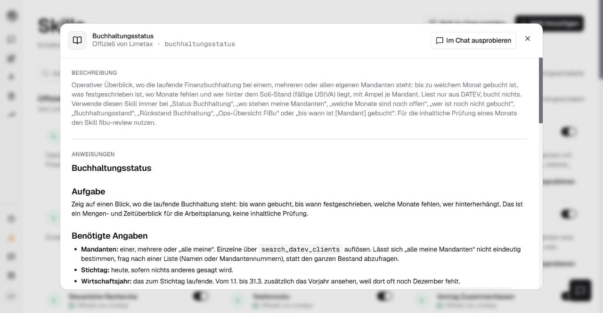

Neun Skills kommen von Limetax, sind geprüft und bei allen Kanzleien eingeschaltet. Die Tabelle zeigt, womit du sie auslöst — darunter steht je Skill, was er braucht und wie Ava vorgeht.

<Note>
  In der App stehen die Namen ohne Umlaute, also **Dokument Uebersetzen** und **Mandantengespraech Vorbereiten**. Gemeint ist derselbe Skill.
</Note>

| Skill | Was er macht | Womit du ihn auslöst |
| --- | --- | --- |
| **Buchhaltungsstatus** | Zeigt je Mandant, bis wann gebucht und festgeschrieben ist und wer hinter der fälligen UStVA liegt | „Status Buchhaltung", „wo stehen meine Mandanten", „bis wann ist [Mandant] gebucht" |
| **Dokument übersetzen** | Übersetzt ein hochgeladenes Dokument vollständig und gibt es als Datei zurück | „übersetze", „Dokument übersetzen", „was steht in diesem Schreiben" |
| **Handelsregister-Abgleich** | Gleicht die DATEV-Stammdaten mit dem Handelsregister ab und zeigt, was veraltet ist | „HR-Abgleich", „Handelsregister prüfen", „sind die Stammdaten noch aktuell" |
| **Mail-Zusammenfassung** | Morgen-Check des Posteingangs: fasst jede ungelesene Mail zusammen und sortiert nach Dringlichkeit | „Morgen-Check", „Posteingang durchgehen", „was ist heute dringend" |
| **Mandantengespräch vorbereiten** | Briefing vor dem Termin: Ampel, offene Mandantenfragen, Bescheide, To-dos, BWA-Auffälligkeiten | „Mandantengespräch vorbereiten", „Briefing für [Mandant]", „Jahresgespräch" |
| **Offene Posten als Excel je Konto** | Excel mit einem Tab je Debitor und Kreditor, alte Posten als *zu klären* markiert | „offene Posten als Excel", „OPOS je Konto", „Posten älter als 60 Tage prüfen" |
| **Steuerliche Recherche** | Recherche über TaxGraph mit belegten Quellen, auf Wunsch als Aktenvermerk | „recherchiere", „wie ist die Rechtslage", „gibt es dazu Rechtsprechung" |
| **Telefonnotiz** | Macht aus Diktat oder Stichpunkten eine Notiz für die Akte | „Telefonnotiz", „Gesprächsnotiz", „Telefonat dokumentieren" |
| **Vertrag zusammenfassen** | Wertet einen Vertrag nach HGB aus, schlägt Buchungen vor und entwirft Rückfragen | „Vertrag zusammenfassen", „wie buche ich diesen Vertrag", „Leasingvertrag prüfen" |

## Wie Ava bei den einzelnen Skills vorgeht

Ein Klick auf den Namen eines Skills öffnet die Detailansicht mit Beschreibung und vollständigen Anweisungen. Die Kurzfassung steht hier:

<Frame caption="Detailansicht eines Skills: Beschreibung mit den Auslösephrasen, darunter die Anweisungen">
  
</Frame>

<AccordionGroup>
  <Accordion title="Buchhaltungsstatus">
    **Braucht:** einen, mehrere oder „alle meine" Mandanten; Stichtag (sonst heute); das laufende Wirtschaftsjahr; den UStVA-Rhythmus aus den Stammdaten.

    **Ablauf:** Ava liest den Buchungs- und Festschreibungsstand aus DATEV und stellt ihn dem Soll-Stand aus der fälligen UStVA gegenüber. Ergebnis ist eine Ampel je Mandant. Von Januar bis März sieht sie zusätzlich ins Vorjahr, weil dort oft noch der Dezember fehlt. Steht kein Rhythmus in den Stammdaten, nimmt sie monatlich ohne Dauerfristverlängerung an und schreibt die Annahme dazu.

    **Grenze:** Mengen- und Zeitüberblick für die Arbeitsplanung, keine inhaltliche Prüfung. Liest nur, bucht nichts.
  </Accordion>

  <Accordion title="Dokument übersetzen">
    **Braucht:** das Dokument als Datei im Chat oder als eingefügten Text, dazu die Zielsprache. Ist keine genannt und das Dokument fremdsprachig, übersetzt Ava ins Deutsche.

    **Ablauf:** Ava nennt die Ausgangssprache und übersetzt vollständig — ohne Zusammenfassen, ohne Auslassen von Klauseln, Fußnoten oder Kleingedrucktem. Gliederung, Nummerierung und Tabellen bleiben erhalten. Fachbegriffe bekommen den in der Zielsprache üblichen Ausdruck; gibt es keinen eindeutigen, steht das Original in Klammern dahinter.

    **Auf Wunsch:** Original und Übersetzung abschnittsweise nebeneinander statt nur der Übersetzung.
  </Accordion>

  <Accordion title="Handelsregister-Abgleich">
    **Braucht:** einen ausgewählten Mandanten und die eingeschaltete Integration **Handelsregister**.

    **Ablauf:** Ava liest Stammdaten und Beteiligte aus DATEV, sucht das Unternehmen nach Firmenname und Sitz, holt die Registerdetails und vergleicht nur Felder, die es in DATEV auch gibt: Firmenname, Rechtsform, Geschäftsführer und so weiter. Zu jeder Abweichung sagt sie, was zu tun ist. Bei mehreren Treffern lässt sie dich wählen.

    **Grenze:** nur für eingetragene Unternehmen (GmbH, UG, AG, KG, OHG, e. K., eG). Bei Privatpersonen und einer GbR ohne Eintrag bricht sie ab.
  </Accordion>

  <Accordion title="Mail-Zusammenfassung">
    **Braucht:** ein verbundenes Microsoft-Konto.

    **Ablauf:** Ava holt alle ungelesenen E-Mails, fasst jede in einem Satz zusammen und sortiert nach dem, was zuerst getan werden muss: Fristen und Behördenpost, Mandantenfragen, eingegangene Unterlagen, Termine, reine Info. Zu jeder Mail nennt sie den nächsten Schritt, markiert Phishing-Verdacht und bietet Antwortentwürfe an.

    **Grenze:** verschickt, löscht und markiert nie selbst.
  </Accordion>

  <Accordion title="Mandantengespräch vorbereiten">
    **Braucht:** den Mandanten; je nach Umfang Postfach und DATEV DMS.

    **Ablauf:** Ava sammelt aus DATEV, deinem Postfach und dem DMS und liefert eine sortierte Übersicht: oben die Ampel-Tabelle *Auf einen Blick*, direkt darunter die noch unbeantworteten Fragen des Mandanten, dann Stammdaten (Stand der Buchhaltung, letzter Jahresabschluss, letzte Steuererklärungen), letzte Bescheide, To-dos und Fristen, BWA-Auffälligkeiten und Gesprächspunkte. Tabellen statt Fließtext, weil das Briefing überflogen und nicht gelesen wird. Zu jeder Angabe steht die Quelle.

    **Grenze:** nur lesen. Und: nicht gefunden heißt nicht nicht vorhanden — Ava schreibt „im DMS nicht gefunden", nicht „nicht abgegeben".
  </Accordion>

  <Accordion title="Offene Posten als Excel je Konto">
    **Braucht:** Mandantennummer und Wirtschaftsjahr. Fehlt das Jahr, nimmt Ava das laufende und nennt die Annahme. Schwelle für *zu klären* sind 60 Tage ab Belegdatum, wenn du nichts anderes sagst.

    **Ablauf:** Ava ruft die offenen Posten für Debitoren und Kreditoren live aus DATEV ab, zuerst ohne Kontofilter und danach jedes Personenkonto einzeln, damit die Liste vollständig ist, und vergleicht die Summen gegeneinander. Ergebnis ist eine Excel mit einem Tab je Personenkonto. Auf Wunsch legt sie die Datei im DMS ab.

    **Beachte:** Ava sagt dir, wenn Zeilen gekürzt, unlesbar oder ohne Fälligkeit waren.
  </Accordion>

  <Accordion title="Steuerliche Recherche">
    **Braucht:** die Fachfrage, Sachverhalt und Rechtsstand.

    **Ablauf:** Ava zerlegt die Frage in Teilfragen und recherchiert über TaxGraph in Gesetz, Richtlinien, BMF-Schreiben sowie BFH- und FG-Rechtsprechung. Jede rechtliche Aussage bekommt Fundstelle und Link; Aktenzeichen und Randnummern, die die Recherche nicht bestätigt hat, schreibt sie nicht hin. Verwaltungsauffassung und Rechtsprechung bleiben getrennt, Unsicherheiten und anhängige Verfahren werden benannt. Maßgeblich ist die Fassung für den jeweiligen Veranlagungszeitraum, nicht automatisch die heutige.

    **Grenze:** bereitet die Entscheidung des Berufsträgers vor, ersetzt sie nicht. Nicht für einfache Fristfragen oder reine Buchungsfragen.
  </Accordion>

  <Accordion title="Telefonnotiz">
    **Braucht:** das Diktat oder die Stichpunkte, dazu den Mandanten.

    **Ablauf:** Ava macht daraus eine einheitliche Notiz mit Kopfdaten, Inhalt, Vereinbarungen und Auskünften, Aufgaben mit Zuständigkeit, Fristen und Rückruf. Zugesagtes und Abgelehntes hält sie so nah am Diktat wie möglich fest. Unverständliches glättet sie nicht, sondern markiert es als `[unklar: …]`.

    **Grenze:** nur was diktiert wurde, keine eigene fachliche Bewertung. Hinweise stehen getrennt unter der Notiz. Ablage im DMS und Bestätigungsmail nur auf ausdrücklichen Wunsch.
  </Accordion>

  <Accordion title="Vertrag zusammenfassen">
    **Braucht:** den Vertrag als Datei im Chat und den Mandanten — die Buchungsvorschläge brauchen seinen Kontenrahmen.

    **Ablauf:** Ava liest den ganzen Vertrag, ermittelt den Kontenrahmen und fasst Vertragsart, Parteien, Hauptleistung und Laufzeit in zwei bis drei Sätzen zusammen. Dann folgt eine Tabelle mit den bilanziell relevanten Konditionen (Zahlungsbedingungen, Anzahlungen, Preisanpassung, Garantien, Kündigungsfristen), dazu Buchungsvorschläge und ein E-Mail-Entwurf mit Rückfragen an den Mandanten.

    **Beachte:** ist eine Seite unleserlich, sagt Ava das, statt zu raten. Lässt sich der Kontenrahmen nicht prüfen, nennt sie Konten für SKR03 und SKR04 und schreibt den Vorbehalt dazu.
  </Accordion>
</AccordionGroup>

<Columns cols={2}>
  <Card title="Skills verstehen" icon="wand-magic-sparkles" href="/skills/ueberblick">
    Ein- und ausschalten, ausprobieren, Auslöser.
  </Card>

  <Card title="Eigenen Skill anlegen" icon="plus" href="/skills/eigenen-skill-anlegen">
    Wenn kein offizieller Skill passt.
  </Card>
</Columns>
