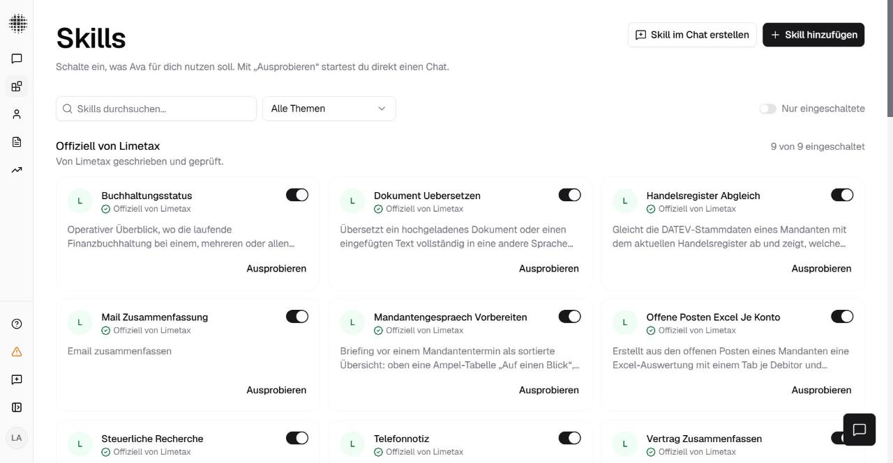

Ein **Skill** ist eine feste Arbeitsanweisung, die Ava für eine wiederkehrende Aufgabe befolgt — eine Telefonnotiz schreiben, den Buchhaltungsstand aller Mandanten ziehen, einen Vertrag auswerten. Du musst nicht jedes Mal neu erklären, was du willst: Du nennst die Aufgabe, Ava arbeitet den hinterlegten Ablauf ab.

Du findest sie in der Seitenleiste unter **Skills**.

## Zwei Arten von Skills

| Bereich | Wer schreibt sie | Wer sieht sie |
| --- | --- | --- |
| **Offiziell von Limetax** | von Limetax geschrieben und geprüft | alle Kanzleien |
| **Eigene Skills** | du selbst | nur du |

<Note>
  Eigene Skills hängen an deinem Konto. Eine Kollegin sieht deinen Skill nicht, auch wenn ihr am selben Mandanten arbeitet.
</Note>

## Einen Skill starten

<Steps>
  <Step title="Skills öffnen">
    Klicke in der Seitenleiste auf **Skills**. Über der Liste filterst du mit **Skills durchsuchen**, dem Dropdown **Thema** und dem Schalter **Nur eingeschaltete**.

    <Frame caption="Die Skill-Liste: oben die Filter, darunter die offiziellen Skills mit Schalter und Ausprobieren">
      
    </Frame>
  </Step>

  <Step title="Prüfen, ob er eingeschaltet ist">
    Jeder Skill hat rechts einen Schalter. Ava zieht nur eingeschaltete Skills. Über der Liste steht, wie viele gerade aktiv sind, zum Beispiel *9 von 9 eingeschaltet*.
  </Step>

  <Step title="Ausprobieren">
    **Ausprobieren** öffnet direkt einen Chat mit diesem Skill. Der schnellste Weg, wenn du ihn zum ersten Mal nutzt.
  </Step>
</Steps>

## Meistens rufst du gar keinen Skill auf

Der Normalfall ist: Du schreibst im Chat, was du brauchst, und Ava entscheidet anhand der **Beschreibung** des Skills, ob sie ihn lädt. Deshalb steht in jeder Beschreibung, womit der Skill ausgelöst wird.

Beim **Buchhaltungsstatus** sind das zum Beispiel „Status Buchhaltung", „wo stehen meine Mandanten" oder „bis wann ist [Mandant] gebucht". Welcher Skill auf welche Formulierung anspringt, steht unter [Die Limetax-Skills](/skills/limetax-skills).

<Tip>
  Springt ein Skill nicht an, nimm eine Formulierung aus seiner Beschreibung wörtlich. Das ist zuverlässiger als eine Umschreibung.
</Tip>

## Was ein Skill nicht ändert

Ein Skill ist eine Anweisung, keine Freigabe. Die Skills lesen aus DATEV, dem DATEV DMS und deinem Postfach, legen Dateien ab oder bereiten Buchungsstapel vor. Die fachliche Prüfung und das Festschreiben bleiben bei dir.

<Columns cols={2}>
  <Card title="Die Limetax-Skills" icon="list-check" href="/skills/limetax-skills">
    Was die neun offiziellen Skills tun und womit du sie auslöst.
  </Card>

  <Card title="Eigenen Skill anlegen" icon="plus" href="/skills/eigenen-skill-anlegen">
    Name, Beschreibung, Tags und Anweisungen.
  </Card>
</Columns>
